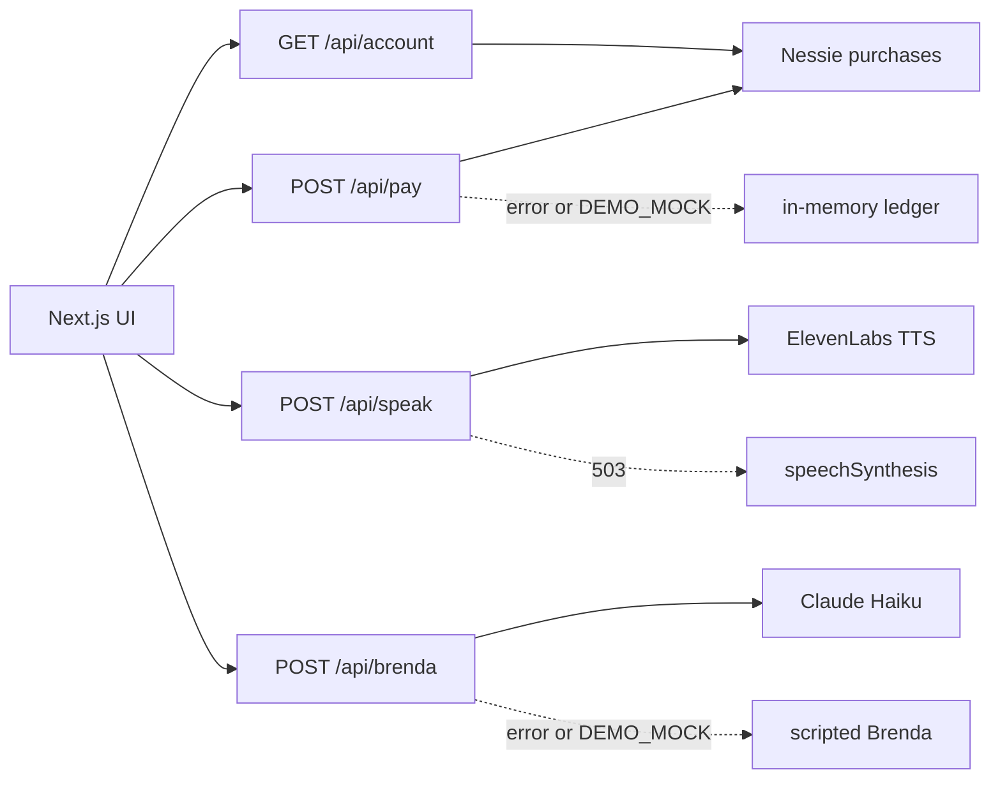

# SnoozeFlix

The alarm clock you can only turn off by paying for a subscription.

SnoozeFlix is a satire of subscription dark patterns. The stakes are fake. The API calls are real when keys are present: Capital One's Nessie sandbox moves the money, ElevenLabs speaks the alarm and the retention agent, and Claude writes Brenda's replies. With no keys, the same screens run on an in-memory ledger and the browser's speech synthesizer, so a demo never dies on venue wifi.

## Problem

People already hate the "cancel" maze, the surprise fee, and the plan that gets more expensive because you used it. SnoozeFlix puts that maze on the one button everyone needs in the morning: stop the alarm. There is no dismiss. There is a dismiss-shaped button, and it runs away.

## What the judge should see

1. **Ring now** plays a looping alarm and an ElevenLabs wake-up line: "Good morning! Your free trial of being awake has ended."
2. The Dismiss button flees from the pointer. The only exit is a plan.
3. **Snooze Pass** is a real Nessie purchase at $0.99, then $1.98, then $3.96. Silence lasts 20 seconds. The label is "Dynamic demand pricing."
4. **Basic** ($4.99) plays an unskippable pillow ad, teases skip, then stops the alarm. One or two surprise fees post as separate purchases: Wake-Up Fee $0.49, Timezone Convenience Fee $0.25.
5. **My Account** shows the live Nessie balance, an invoice table, sleep points worth nothing, and total spent waking up.
6. **Cancel subscription** is four guilt screens, then Brenda. She answers in Claude's voice, spoken by ElevenLabs. After three replies she gives up and posts a Cancellation Fee of $2.99.

## Architecture



Keys stay in route handlers. The browser only calls `/api/*`.

## Real API calls

| Call | Where | Body |
|---|---|---|
| `POST /customers` | `npm run setup:nessie` | `first_name`, `last_name`, `address` (`zip`) |
| `POST /customers/{id}/accounts` | setup | `type: Checking`, `nickname`, `rewards`, `balance: 500` |
| `POST /merchants` | setup | `name: SnoozeFlix Inc.`, `category`, `address`, `geocode` |
| `POST /accounts/{id}/purchases` | `/api/pay` | `merchant_id`, `medium: balance`, `purchase_date`, `amount`, `description` |
| `GET /accounts/{id}` | `/api/account` | balance |
| `GET /accounts/{id}/purchases` | `/api/account` | invoice rows |
| `POST https://api.elevenlabs.io/v1/text-to-speech/{voice_id}` | `/api/speak` | `{ text, model_id: eleven_multilingual_v2 }` |
| Anthropic Messages `claude-haiku-4-5-20251001` | `/api/brenda` | Brenda system prompt, max 150 tokens |

Nessie purchases often stay `pending` and do not lower `balance` immediately. The dashboard shows balance minus pending amounts.

## Run

```bash
npm install
cp .env.example .env.local
npm run dev
```

Open http://localhost:3000. With empty keys the app uses the demo ledger. Click **Ring now (demo)** and buy a plan.

Live sandbox:

1. Put `NESSIE_API_KEY` in `.env.local` (http://api.nessieisreal.com, GitHub login).
2. `npm run setup:nessie` and paste `NESSIE_ACCOUNT_ID` and `NESSIE_MERCHANT_ID`.
3. Add `ELEVENLABS_API_KEY`, `ELEVENLABS_VOICE_ALARM`, `ELEVENLABS_VOICE_BRENDA`.
4. Add `ANTHROPIC_API_KEY`.
5. Keep `DEMO_MOCK=false` and restart `npm run dev`.

`DEMO_MOCK=true` forces the fake ledger and scripted voices even if keys exist.

### FREE-WiLi (optional hardware)

When the alarm rings, a USB-connected FREE-WiLi flashes all seven LEDs red and plays the ElevenLabs wake-up line from its own speaker. Paying turns it off.

1. Flash OG firmware v024 or newer (`fwogcli flash ogfw_main-024.uf2 --cpu main`).
2. `py -3.12 -m pip install -e <fwcom>/onewili-python` (needs Python 3.10+).
3. `npm run setup:wili` generates the line with ElevenLabs as 16 kHz PCM WAV and uploads it to `/sounds/wake.wav` on the board.
4. Set `FREEWILI_ENABLED=true` and, if needed, `FREEWILI_PYTHON` in `.env.local`.

`POST /api/wili {action: "ring" | "stop"}` runs `scripts/freewili.py`. If the board is unplugged, the error goes to the server log and the demo keeps going.

## Demo script (about 90 seconds)

Arm is optional if you press Ring now. Buy Snooze Pass, wait for the second ring, show the doubled price, buy Basic, sit through the ad, open My Account, then cancel until Brenda cries and the cancellation fee lands.
